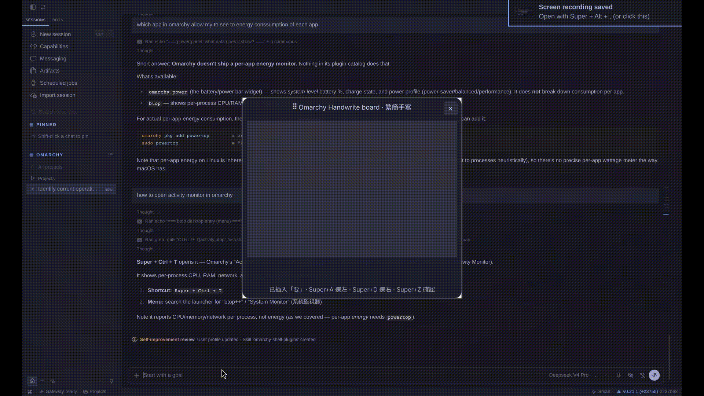

<div align="center">
  
  <br>
  <h1 style="margin: 10px 0; font-size: 2.5rem;">Omarchy Handwrite board</h1>
  <h2 style="margin: 10px 0; font-size: 1.5rem;">繁簡手寫板</h2>
  <br>
  <span>Write Traditional or Simplified Chinese characters with your trackpad/mouse — a native Omarchy shell plugin.</span>
</div>



## How it works

1. A floating panel opens (summon it with `SUPER+SHIFT+H`).
2. Draw on the writing area with your touchpad (or mouse). The panel is a
   **Quickshell QML plugin** that runs inside the Omarchy shell; a small
   headless Python backend captures the touchpad and runs recognition.
3. ~0.7 s after you lift, the strokes are recognized with the official
   **PP-OCRv6** model (ONNX via `onnxruntime`, no torch) — one model covers
   both **Traditional and Simplified** Chinese (18,708 chars).
4. Candidate characters appear with the most likely one auto-selected; it
   **auto-fills** into your app after a short pause. Click other candidate or presss **Super+A** or **Super+D** to choose the left or right candidate.
   p=ress **Super+Z** to confirm immediately.


## Install

It's an Omarchy shell plugin (a `panel` kind):

```bash
# From a git repo:
omarchy plugin add https://github.com/<you>/omarchy-write.git --enable --yes

# Or drop it in by hand:
#   put it in ~/.config/omarchy/plugins/jack.omarchy-write/
#   omarchy-shell shell rescanPlugins
#   omarchy plugin enable jack.omarchy-write
```

Then install the Python backend (a venv with the OCR/touchpad deps) and the
udev rules:

```bash
cd ~/.config/omarchy/plugins/jack.omarchy-write
./install.sh            # venv + pip deps; udev rules (needs sudo, prompts below)
```

The model (21 MB) + charset ship in `models/` — no first-run download needed.


## Hotkeys

| Hotkey|Function|
|-------|--------|
|`SUPER+SHIFT+H`|Summon Panel|
|`SUPER+Z`|Select the word|
|`SUPER+A`|Choose the left word|
|`SUPER+D`|Choose the right word|


## Files

```
manifest.json     Omarchy plugin manifest (panel kind)
Handwrite.qml     Quickshell panel: window, canvas, candidates, IPC
backend.py        Headless Python backend: touchpad + OCR + insert (stdio IPC)
omarchy_write/    Reusable Python modules (recognizer, render, insert, touchpad)
models/           PP-OCRv6 ONNX model + charset
assets/           Icon + demo video
install.sh        Backend venv + udev rules
uninstall.sh      Reverse of install.sh
```